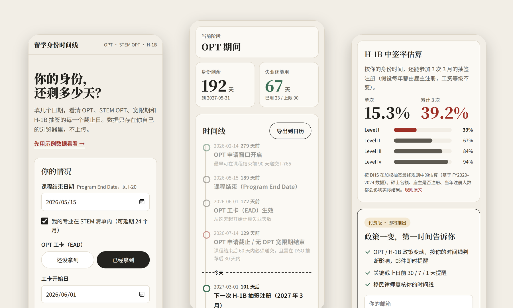
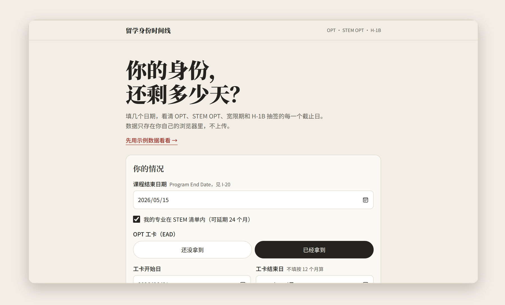

<div align="center">

[简体中文](README.md) · [繁體中文](README.zh-TW.md) · **English**

# Visa Status Timeline

**How many days of status do you have left?**

An OPT / STEM OPT / H-1B status helper for Chinese-speaking international students in the US.<br>
Enter a few dates and see every deadline that matters.

[**→ Open the app**](https://yaohaoliang141-max.github.io/visa-helper/) &nbsp;·&nbsp; [**Try it with sample data**](https://yaohaoliang141-max.github.io/visa-helper/?demo#result)

<br>



<sub>The interface is currently in Simplified Chinese. English and Traditional Chinese interfaces are planned.</sub>

</div>

<br>

## What it shows you

| | |
|---|---|
| **Days of status left** | Your current phase (pre-OPT / OPT / STEM OPT / grace period) and how many days remain |
| **Unemployment days left** | 90 days on OPT, 150 in total with STEM OPT; turns red when you are close, warns when you are over |
| **Full timeline** | OPT filing window, EAD expiry, STEM OPT filing window, 60-day grace period, cap-gap, next lottery |
| **H-1B selection odds** | Based on the wage-weighted lottery that began in 2026: single-round odds and cumulative odds across your remaining rounds |
| **Calendar export** | One click creates an `.ics` file with a reminder 7 days before each deadline; works with iPhone and Google Calendar |
| **Policy updates** | A short digest of recent changes, each linked to an official or reputable source |

<div align="center">

</div>

## Privacy

- No sign-up, and no uploading of your I-20, passport or any document
- Everything you enter **stays in your own browser**; we never see it

## Sources for the rules

Every date rule was checked against official guidance, and the sources are cited in code comments ([`js/rules.js`](js/rules.js), [`js/lottery.js`](js/lottery.js)):

- [Study in the States: F-1 OPT](https://studyinthestates.dhs.gov/sevis-help-hub/student-records/fm-student-employment/f-1-optional-practical-training-opt)
- [USCIS: STEM OPT extension](https://www.uscis.gov/working-in-the-united-states/students-and-exchange-visitors/optional-practical-training-extension-for-stem-students-stem-opt)
- [Federal Register: H-1B weighted selection final rule](https://www.federalregister.gov/documents/2025/12/29/2025-23853/weighted-selection-process-for-registrants-and-petitioners-seeking-to-file-cap-subject-h-1b)

> [!IMPORTANT]
> For reference only, not legal advice. Confirm your situation with USCIS and your school's DSO.

## Run locally

A static site with no dependencies and no build step:

```bash
python -m http.server 5173   # open http://localhost:5173
npm test                     # run the rule tests
```

<details>
<summary>Project layout and maintenance</summary>

```
index.html          page
css/style.css       styles
js/rules.js         status timeline rule engine (pure functions)
js/lottery.js       H-1B selection odds
js/ics.js           calendar export
js/policy.js        policy updates (add new entries at the top and bump POLICY_UPDATED)
js/config.js        waitlist endpoint (Formspree)
tests/              rule tests (node --test)
```

</details>
