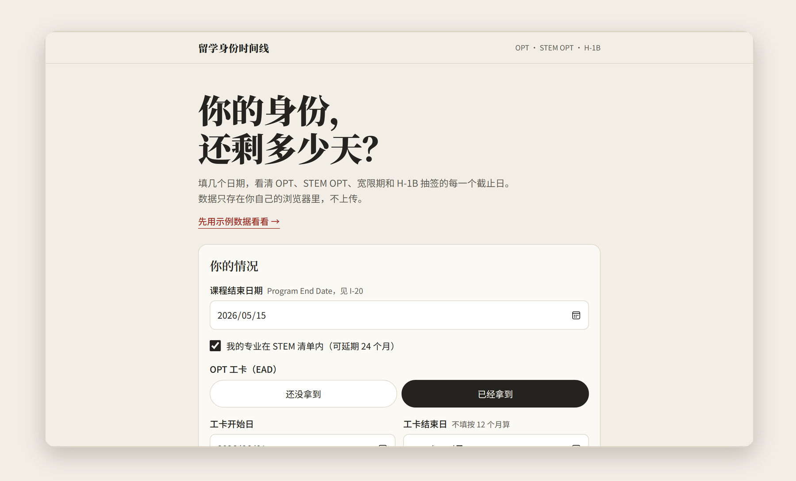

<div align="center">

**简体中文** · [繁體中文](README.zh-TW.md) · [English](README.en.md)

# 留学身份时间线

**你的身份，还剩多少天？**

给在美中国留学生的 OPT / STEM OPT / H-1B 身份助手。<br>
填几个日期，看清每一个截止日。

[**→ 立即使用**](https://yaohaoliang141-max.github.io/visa-helper/) &nbsp;·&nbsp; [**用示例数据看看**](https://yaohaoliang141-max.github.io/visa-helper/?demo#result)

<br>


</div>

<br>

## 它能帮你看清什么

| | |
|---|---|
| **身份剩余天数** | 当前处于哪个阶段（等待 OPT / OPT / STEM OPT / 宽限期），身份还剩多少天 |
| **失业天数余量** | OPT 上限 90 天，含 STEM OPT 合计 150 天；快用完变红，超限立即提醒 |
| **完整时间线** | OPT 申请窗口、工卡到期、STEM OPT 申请窗口、60 天宽限期、Cap-gap、下一次抽签 |
| **H-1B 中签率** | 按 2026 年起的工资等级加权抽签，算出单次和“还能抽几次”的累计概率 |
| **导出到日历** | 一键生成 `.ics`，每个关键日期提前 7 天提醒，iPhone / Google 日历都能用 |
| **政策动态** | 最新政策汇总，每条附官方或权威来源 |

<div align="center">

</div>

## 隐私

- 不需要注册，不需要上传 I-20、护照或任何证件
- 你填写的内容**只保存在你自己的浏览器里**，我们看不到

## 规则依据

所有日期规则都对照了官方资料，出处写在代码注释里（[`js/rules.js`](js/rules.js)、[`js/lottery.js`](js/lottery.js)）：

- [Study in the States：F-1 OPT](https://studyinthestates.dhs.gov/sevis-help-hub/student-records/fm-student-employment/f-1-optional-practical-training-opt)
- [USCIS：STEM OPT 延期](https://www.uscis.gov/working-in-the-united-states/students-and-exchange-visitors/optional-practical-training-extension-for-stem-students-stem-opt)
- [Federal Register：H-1B 加权抽签最终规则](https://www.federalregister.gov/documents/2025/12/29/2025-23853/weighted-selection-process-for-registrants-and-petitioners-seeking-to-file-cap-subject-h-1b)

> [!IMPORTANT]
> 仅供参考，不构成法律意见。你的具体情况请以 USCIS 和学校 DSO 为准。

## 本地运行

纯静态网页，没有依赖，不需要构建：

```bash
python -m http.server 5173   # 打开 http://localhost:5173
npm test                     # 运行规则测试
```

<details>
<summary>项目结构与维护</summary>

```
index.html          页面
css/style.css       样式
js/rules.js         身份时间线规则引擎（纯函数）
js/lottery.js       H-1B 中签率
js/ics.js           日历导出
js/policy.js        政策动态（新条目加在最上面，并更新 POLICY_UPDATED）
js/config.js        付费意向收集地址（Formspree）
tests/              规则测试（node --test）
```

</details>
