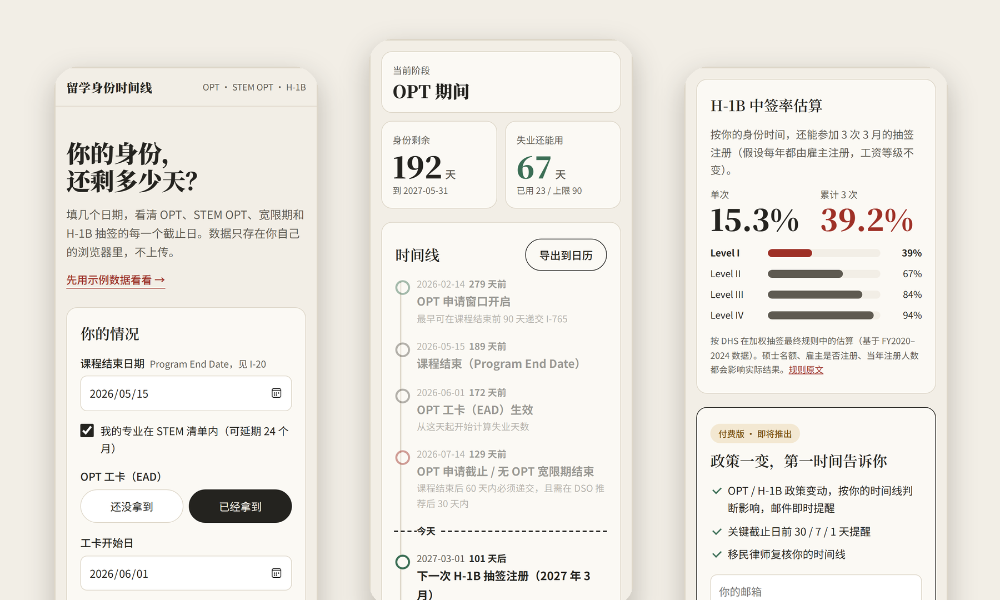
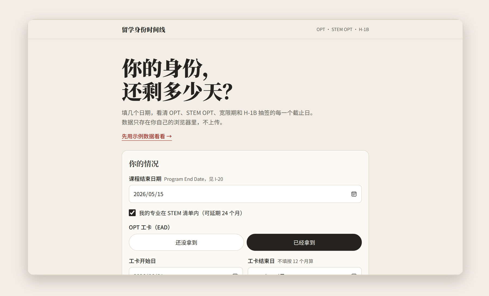

<div align="center">

[简体中文](README.md) · **繁體中文** · [English](README.en.md)

# 留學身分時間線

**你的身分，還剩多少天？**

給在美國留學的華人學生的 OPT / STEM OPT / H-1B 身分助手。<br>
填幾個日期，看清每一個截止日。

[**→ 立即使用**](https://yaohaoliang141-max.github.io/visa-helper/) &nbsp;·&nbsp; [**用範例資料看看**](https://yaohaoliang141-max.github.io/visa-helper/?demo#result)

<br>



<sub>目前介面為簡體中文，繁體中文介面規劃中。</sub>

</div>

<br>

## 它能幫你看清什麼

| | |
|---|---|
| **身分剩餘天數** | 目前處於哪個階段（等待 OPT / OPT / STEM OPT / 寬限期），身分還剩多少天 |
| **失業天數餘額** | OPT 上限 90 天，含 STEM OPT 合計 150 天；快用完時變紅，超過上限立即提醒 |
| **完整時間線** | OPT 申請窗口、工卡到期、STEM OPT 申請窗口、60 天寬限期、Cap-gap、下一次抽籤 |
| **H-1B 中籤率** | 依 2026 年起的薪資等級加權抽籤，算出單次與「還能抽幾次」的累計機率 |
| **匯出到行事曆** | 一鍵產生 `.ics`，每個關鍵日期提前 7 天提醒，iPhone / Google 行事曆皆可使用 |
| **政策動態** | 最新政策整理，每則附官方或權威來源 |

<div align="center">

</div>

## 隱私

- 不需要註冊，不需要上傳 I-20、護照或任何證件
- 你填寫的內容**只儲存在你自己的瀏覽器裡**，我們看不到

## 規則依據

所有日期規則都對照了官方資料，出處寫在程式碼註解中（[`js/rules.js`](js/rules.js)、[`js/lottery.js`](js/lottery.js)）：

- [Study in the States：F-1 OPT](https://studyinthestates.dhs.gov/sevis-help-hub/student-records/fm-student-employment/f-1-optional-practical-training-opt)
- [USCIS：STEM OPT 延期](https://www.uscis.gov/working-in-the-united-states/students-and-exchange-visitors/optional-practical-training-extension-for-stem-students-stem-opt)
- [Federal Register：H-1B 加權抽籤最終規則](https://www.federalregister.gov/documents/2025/12/29/2025-23853/weighted-selection-process-for-registrants-and-petitioners-seeking-to-file-cap-subject-h-1b)

> [!IMPORTANT]
> 僅供參考，不構成法律意見。你的具體情況請以 USCIS 及學校 DSO 為準。

## 本機執行

純靜態網頁，沒有相依套件，不需要建置：

```bash
python -m http.server 5173   # 開啟 http://localhost:5173
npm test                     # 執行規則測試
```

<details>
<summary>專案結構與維護</summary>

```
index.html          頁面
css/style.css       樣式
js/rules.js         身分時間線規則引擎（純函式）
js/lottery.js       H-1B 中籤率
js/ics.js           行事曆匯出
js/policy.js        政策動態（新條目加在最上面，並更新 POLICY_UPDATED）
js/config.js        付費意向收集網址（Formspree）
tests/              規則測試（node --test）
```

</details>
